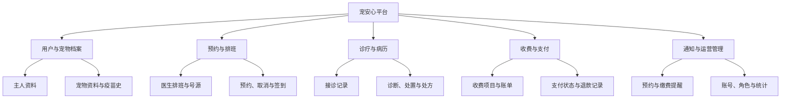
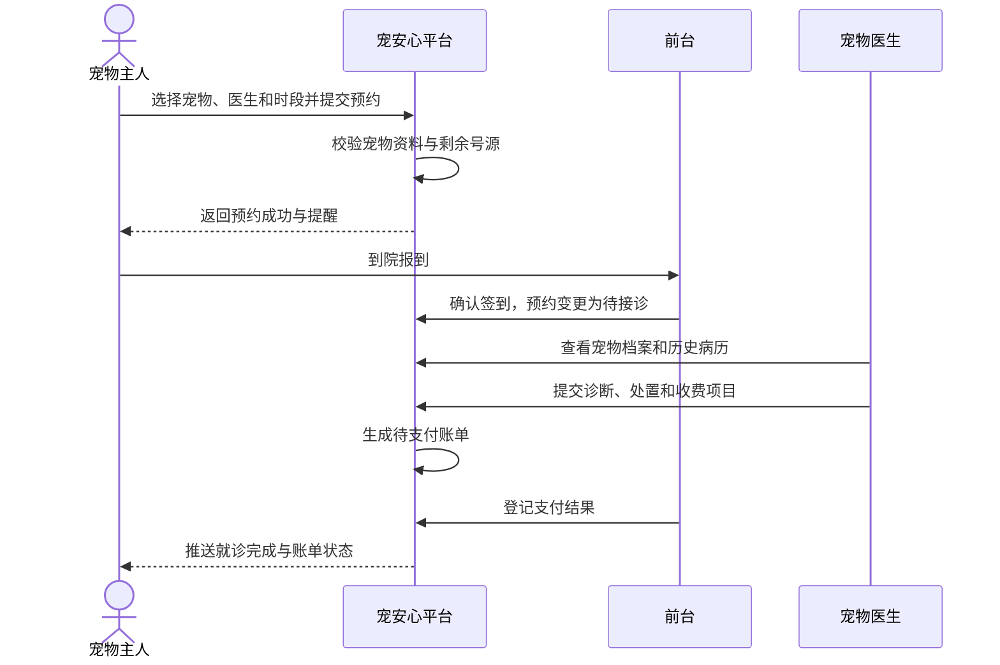

# 宠安心——宠物医院预约与诊疗管理系统

> 面向中小型宠物医院的预约、接诊、病历与收费协同平台。

## 项目简介

“宠安心”是本学期唯一持续演进的微服务课程项目。它围绕宠物从建档、预约就诊、医生接诊、形成病历到收费结算的完整业务闭环，解决小型宠物医院依赖纸质记录、电话预约和分散表格管理时出现的排队不透明、信息易遗漏、病历难追溯等问题。

项目的首个版本聚焦单院区的基础业务协同；后续将按课程进度逐步引入数据库持久化、服务拆分、认证授权、异步消息、分布式事务、可观测性和容器化部署能力。

## 业务背景

随着家庭宠物数量增加，宠物医院需要同时维护主人信息、宠物档案、医生排班、预约队列、诊疗记录与费用明细。传统手工登记或多份独立表格会造成预约冲突、接诊时历史信息缺失、收费项目遗漏，以及主人无法及时获知预约状态等问题。

本项目通过统一的业务平台连接前台、医生和宠物主人：前台能够安排并调整预约，医生能够查看就诊背景并记录诊疗过程，主人能够维护宠物档案、发起预约并查询结果。这样既降低日常运营成本，也为后续扩展药品库存、检验检查和多院区协同预留空间。

## 项目目标与适用场景

| 目标 | 说明 |
| --- | --- |
| 提升预约效率 | 让可预约时段、预约状态和接诊顺序可查询、可调整。 |
| 沉淀诊疗数据 | 将宠物档案、病历、处方和收费记录关联保存，便于后续追溯。 |
| 明确岗位协作 | 为主人、前台、医生和管理员提供与职责匹配的操作入口。 |
| 支撑课程演进 | 从清晰的领域模型出发，逐步实践微服务体系中的关键技术。 |

适用对象为提供门诊、疫苗、驱虫、常规检查等服务的中小型单院区宠物医院；当前不以大型连锁医院、急诊调度或远程诊疗为目标。

## 目标用户与需求

| 角色 | 核心需求 |
| --- | --- |
| 宠物主人 | 注册并维护本人和宠物资料；查看医生可约时段；提交、取消或查看预约；查询诊疗结果和待支付费用。 |
| 前台工作人员 | 管理主人、宠物与医生基础信息；代客预约；确认到院、调整预约状态；生成收费单并登记支付结果。 |
| 宠物医生 | 查看当天接诊列表和宠物历史记录；记录症状、诊断、处置建议与处方；提交完成诊疗的病历。 |
| 系统管理员 | 维护科室、医生、号源与收费项目；管理账号与角色；查看基础运营统计。 |

## 功能设计



| 模块 | 具体功能 |
| --- | --- |
| 用户与宠物档案 | 主人注册与联系方式维护；宠物品种、年龄、过敏史、疫苗史等档案管理；主人与宠物归属关系维护。 |
| 预约与排班 | 医生排班和可预约号源配置；主人自助预约、前台代约、取消与改约；预约状态流转、到院签到和爽约标记。 |
| 诊疗与病历 | 医生查看预约及历史病历；记录主诉、体征、初步诊断、处置建议和处方；病历完成后供主人查询。 |
| 收费与支付 | 按诊疗项目生成账单；记录应收、实收、支付方式和支付状态；支持未支付提醒与退款记录。 |
| 通知与运营管理 | 预约成功、变更、就诊提醒和缴费提醒；账号、角色、医生、科室及收费项目管理；基础预约与营收统计。 |

## 核心业务流程：预约就诊与结算



流程说明：主人先为已建档宠物选择有效号源，系统校验后创建预约；到院后由前台签到，医生完成接诊并提交病历和收费项目；系统据此生成账单，前台确认支付后将本次就诊闭环为“已完成”。后续版本会把关键状态变更以消息方式发送给通知等下游服务。

## 当前范围与暂不实现内容

当前项目以“单院区、常规门诊、人工确认收费”为边界，优先实现宠物档案、预约、接诊病历和账单的基本闭环。

暂不实现：真实第三方支付扣款、药品供应链与库存盘点、检验设备对接、影像文件存储、在线问诊、处方合规审核、急诊分诊及多院区跨店调度。这些内容要么需要外部系统与监管要求，要么会显著扩大首期项目范围，可在基础业务稳定后另行评估。

## 后续演进方向

| 课程主题 | 演进计划 |
| --- | --- |
| 数据库持久化 | 为主人、宠物、排班、预约、病历、账单等核心实体设计关系模型，并补充索引、审计字段和数据初始化。 |
| 认证与授权 | 引入统一身份认证及基于角色的访问控制；主人仅能访问自己的宠物与订单，医生仅能维护自己接诊的病历。 |
| 服务拆分 | 按领域拆分为档案服务、预约服务、诊疗服务、收费服务和通知服务，通过 API 网关统一对外提供能力。 |
| 消息与异步协作 | 使用消息队列发布预约创建、预约取消、诊疗完成和支付完成事件，驱动提醒、统计等异步流程。 |
| 分布式事务 | 对“预约占号”“诊疗完成后生成账单”等跨服务场景设计幂等、补偿与最终一致性方案。 |
| 监控与日志 | 建立统一日志、指标、健康检查和调用链追踪，关注预约成功率、号源使用率、支付成功率和接口延迟。 |
| 部署与交付 | 使用容器化方式部署各服务及依赖组件，补充环境配置、自动化构建与测试，并逐步支持多环境发布。 |

## 选择该题目的原因

宠物医院场景既有清晰的业务主线，又包含多个相互协作的角色和实体。它不像单纯的信息展示系统那样缺少状态变化，也不会像完整电商或大型医院系统那样在第一阶段就引入过多外部依赖。预约、病历、账单等边界天然适合后续服务拆分；号源占用、账单生成和消息提醒也提供了认证、事务和异步通信的真实练习场景，因此适合作为贯穿本学期的持续演进项目。

## 仓库说明

- 课程：微服务课程
- 姓名：陈昊睿
- 学号：2412190531
- 第 2 周作业记录：[docs/homework/week-02/index.md](docs/homework/week-02/index.md)
- `src/`：后续课程代码。

## 第 03 周：单体工程运行说明

本周在 `monolith/` 中创建了“宠安心”的单体 Spring Boot 工程。运行环境要求 Java 21 与 Maven（项目包含 Maven Wrapper），使用 Spring Boot 4.0.8、Spring Web MVC 和 Actuator，默认端口为 `8080`。

```bash
cd monolith
./mvnw test
./mvnw spring-boot:run
```

应用启动后可验证：

- 问候接口：`GET http://localhost:8080/api/hello`
- 健康检查：`GET http://localhost:8080/actuator/health`

本周仅包含启动、基础配置、运行状态接口和启动测试；尚未实现宠物档案、预约、接诊病历、收费、数据库、Service、Repository 或完整业务 API。

## 第 04 周：宠物预约 API 与数据库

第 04 周在同一个 `monolith/` 工程中实现“宠物建档 → 创建预约 → 查询预约”。应用使用 Java 21、Maven 和 Spring Boot 4.0.8；默认启动使用 H2 内存数据库，方便本地运行和自动化测试。生产式本地验证可切换到 MySQL profile。

### 启动与测试

```bash
cd monolith
./mvnw test
./mvnw spring-boot:run
```

Windows PowerShell 可执行 `./mvnw.cmd test` 与 `./mvnw.cmd spring-boot:run`。默认地址为 `http://localhost:8080`。

### API 示例

先创建宠物：

```bash
curl -i -X POST http://localhost:8080/api/pets \
  -H "Content-Type: application/json" \
  -d '{"name":"团团","ownerName":"陈昊睿","ownerPhone":"13800000000","species":"猫"}'
```

创建预约（将 `petId` 替换为上一步返回的 id，时间需在未来）：

```bash
curl -i -X POST http://localhost:8080/api/appointments \
  -H "Content-Type: application/json" \
  -d '{"petId":1,"appointmentTime":"2026-12-01T10:00:00","reason":"年度体检"}'
```

还可使用 `GET /api/pets`、`GET /api/pets/{id}`、`GET /api/appointments?petId={id}` 查询数据。重复为同一宠物创建同一时段的预约会返回 `409 Conflict`。

### MySQL 安装、建库与连接

安装 MySQL 8.x 后创建数据库：

```sql
CREATE DATABASE pet_care DEFAULT CHARACTER SET utf8mb4;
```

设置账号密码并使用 `mysql` profile 启动。JPA 会依据实体自动建表（`ddl-auto=update`）：

```bash
MYSQL_USERNAME=root MYSQL_PASSWORD=你的密码 ./mvnw spring-boot:run -Dspring-boot.run.profiles=mysql
```

Windows PowerShell 使用：

```powershell
$env:MYSQL_USERNAME="root"
$env:MYSQL_PASSWORD="你的密码"
.\mvnw.cmd spring-boot:run "-Dspring-boot.run.profiles=mysql"
```

表关系、字段和约束见 [docs/database.md](docs/database.md)。当前未实现医生排班、签到/取消、病历、收费、认证授权及真实通知能力。

## 第 05 周：Docker Compose 启动

本项目可通过 Docker Compose 一次启动 Spring Boot 应用与 MySQL 8.4.11。Docker 构建在容器内执行 Maven Wrapper，多阶段镜像的运行阶段只包含 JRE 和可执行 JAR。

```bash
cp .env.example .env
docker compose up -d --build
docker compose ps
```

Windows PowerShell：

```powershell
Copy-Item .env.example .env
docker compose up -d --build
docker compose ps
```

应用使用容器网络中的 `mysql` 服务名连接数据库，数据库数据保存在命名卷 `mysql_data`。查看日志与停止服务：

```bash
docker compose logs app
docker compose down
```

不要使用 `docker compose down -v`，否则会删除用于持久化 MySQL 数据的命名卷。

### 容器化接口示例

```bash
curl http://localhost:8080/actuator/health
curl -X POST http://localhost:8080/api/pets -H "Content-Type: application/json" -d '{"name":"团团","ownerName":"陈昊睿","ownerPhone":"13800000000","species":"猫"}'
curl http://localhost:8080/api/pets
```

## 第 06 周：微服务拆分与本地编排

单体版本继续保留在 `monolith/`；拆分后的独立 Spring Boot 工程位于 `services/`：user-service、pet-service、appointment-service。服务分别使用宿主机端口 8081、8082、8083；每个服务均有独立数据库账号和数据表。服务边界与调用图见 [docs/microservices-design.md](docs/microservices-design.md)。

### 启动、测试与健康检查

复制环境变量模板后，在仓库根目录启动全部服务：

```bash
cp .env.example .env
docker compose up -d --build
docker compose ps
bash scripts/smoke-test.sh
```

Windows PowerShell 中可使用 `Copy-Item .env.example .env`，并在 Git Bash 中执行 `bash scripts/smoke-test.sh`。独立测试可在每个服务目录执行 `mvn test`；若使用 Maven Wrapper，可使用相应的 `mvnw.cmd test`。

### 微服务 API 示例

```bash
# 创建主人（user-service）
curl -i -X POST http://localhost:8081/api/users -H "Content-Type: application/json" -d '{"name":"陈昊睿","phone":"13800000000"}'

# 创建宠物（pet-service）；ownerId 为上一步返回的 id
curl -i -X POST http://localhost:8082/api/pets -H "Content-Type: application/json" -d '{"ownerId":1,"name":"团团","species":"猫"}'

# 创建预约（appointment-service 会通过 HTTP 调用 pet-service 校验 petId）
curl -i -X POST http://localhost:8083/api/appointments -H "Content-Type: application/json" -d '{"petId":1,"appointmentTime":"2026-12-01T10:00:00","reason":"年度体检"}'
```

健康检查地址为 `http://localhost:8081/actuator/health`、`http://localhost:8082/actuator/health` 与 `http://localhost:8083/actuator/health`。第 06 周时 appointment-service 通过 Compose DNS 固定地址访问 pet-service；第 07 周起已改为从 Nacos 服务发现获取实例地址，旧地址配置已删除。

## 第 07 周：Nacos 注册发现与上下线验证

第 07 周在现有 `services/` 工程上接入 Nacos 3.2.4，不重新创建工程。三个服务通过课程统一 Spring Cloud / Spring Cloud Alibaba BOM 引入 Discovery Starter，使用同一命名空间和 `PERSONAL_GROUP` 分组注册；预约创建流程通过 `DiscoveryClient.getInstances("pet-service")` 每次动态获取实例地址，再调用原有 `GET /api/pets/{id}` 完成宠物校验。完整验证过程见 [docs/homework/week-07/index.md](docs/homework/week-07/index.md)。

### 端口与配置

| 组件 | 本机地址 | 容器端口 | 说明 |
| --- | --- | --- | --- |
| Nacos 控制台 | <http://localhost:18080/> | 8080 | 只绑定 `127.0.0.1`，不要使用旧的 `8848/nacos` 控制台地址 |
| Nacos HTTP API | `http://localhost:8848` | 8848 | 服务端 OpenAPI |
| Nacos SDK gRPC | `localhost:9848` | 9848 | Java 客户端通信端口 |
| user-service | <http://localhost:8081> | 8080 | `spring.application.name=user-service` |
| pet-service | <http://localhost:8082> | 8080 | `spring.application.name=pet-service` |
| appointment-service | <http://localhost:8083> | 8080 | `spring.application.name=appointment-service` |

Nacos 控制台端口、HTTP 端口和 gRPC 端口可分别用 `NACOS_CONSOLE_PORT`、`NACOS_HTTP_PORT`、`NACOS_GRPC_PORT` 覆盖。业务服务宿主机端口可用 `USER_PORT`、`PET_PORT`、`APPOINTMENT_PORT` 覆盖，容器内仍监听 8080。Nacos 数据保存在命名卷 `nacos_data`，MySQL 数据保存在 `microservices_mysql_data`。

### 首次启动 Nacos

真实密码、Token 和身份值只写入被 `.gitignore` 忽略的根目录 `.env`，仓库只提交 `.env.example`。

```bash
cp .env.example .env
# 编辑 .env，至少替换 NACOS_PASSWORD，并生成 Token 与身份值：
openssl rand -base64 32   # 填入 NACOS_AUTH_TOKEN
openssl rand -hex 16      # 填入 NACOS_AUTH_IDENTITY_VALUE
docker compose up -d nacos
docker compose ps nacos
```

等待 Nacos 容器启动（未初始化管理员前 `health: starting` 属正常）后打开 <http://localhost:18080/>，首次使用 `nacos` 管理员账号初始化密码，密码必须与 `.env` 中的 `NACOS_PASSWORD` 一致。初始化完成后，控制台的鉴权健康检查转为 `healthy`，再启动业务服务，避免服务因管理员尚未就绪而注册失败：

```bash
docker compose up -d --build
docker compose ps
bash scripts/smoke-test.sh
```

`screenshots` 和文档中不得出现真实密码或 Token；Nacos 仅绑定本机回环地址，不暴露到公网。

### 注册与分组

- 命名空间：默认 `public`，即 `.env` 中 `NACOS_NAMESPACE` 留空；若创建自定义命名空间，必须填写 Namespace ID，而不是显示名称。
- 分组：`PERSONAL_GROUP`，由 `NACOS_GROUP` 配置，三个服务和调用方保持一致。
- 注册地址：容器内固定使用 `nacos:8848`；本机直接运行 Maven 时默认 `localhost:8848`。
- 鉴权：`NACOS_USERNAME`、`NACOS_PASSWORD` 由环境变量传入；Discovery Starter 版本由课程 BOM 统一管理，本周不引入 Config Starter。

在控制台“服务管理 → 服务列表”中选择上述命名空间和 `PERSONAL_GROUP`，应看到 user-service、pet-service、appointment-service 及其实际容器 IP 和业务端口。

### 服务发现业务调用

预约服务不再保存 `PET_SERVICE_URL`。`PetClient` 每次创建预约前调用 `DiscoveryClient.getInstances("pet-service")`，取当前实例 URI 后请求 `/api/pets/{id}`；实例列表为空时返回 503，远端宠物不存在仍返回 404，失败时不会写入预约记录。HTTP 连接和读取超时仍由 `PET_SERVICE_CONNECT_TIMEOUT`、`PET_SERVICE_READ_TIMEOUT` 控制。

```bash
# 创建宠物后，用返回的 id 创建预约；appointment-service 会先发现 pet-service
curl -i -X POST http://localhost:8082/api/pets \
  -H "Content-Type: application/json" \
  -d '{"ownerId":1,"name":"团团","species":"猫"}'

curl -i -X POST http://localhost:8083/api/appointments \
  -H "Content-Type: application/json" \
  -d '{"petId":1,"appointmentTime":"2026-12-01T10:00:00","reason":"年度体检"}'
```

### 下线与恢复验证

```bash
# 1. 正常调用成功，记录预约数据
curl -i -X POST http://localhost:8083/api/appointments \
  -H "Content-Type: application/json" \
  -d '{"petId":1,"appointmentTime":"2026-12-02T10:00:00","reason":"服务发现验证"}'

# 2. 停止被调用的 pet-service，等待 Nacos 实例列表移除后再次请求
docker compose stop pet-service
curl -i -X POST http://localhost:8083/api/appointments \
  -H "Content-Type: application/json" \
  -d '{"petId":1,"appointmentTime":"2026-12-03T10:00:00","reason":"下线验证"}'

# 3. 恢复 pet-service，等待重新注册和健康检查通过后重试同一请求
docker compose start pet-service
sleep 20
curl -i -X POST http://localhost:8083/api/appointments \
  -H "Content-Type: application/json" \
  -d '{"petId":1,"appointmentTime":"2026-12-03T10:00:00","reason":"下线验证"}'
```

预期：正常请求返回 201；pet-service 下线后返回 503，且 appointment_db 不新增记录；pet-service 恢复并重新注册后，同一请求返回 201。appointment-service 自身的 `/actuator/health` 在 pet-service 下线期间仍可能是 UP，因为这表示应用自身健康，不等于依赖服务健康，也不代表 Nacos 会因 Actuator DOWN 自动摘除实例。

### 服务测试

测试关闭 Nacos 自动注册，使用 H2 和模拟的 `DiscoveryClient`/远程响应，不依赖真实 Nacos 或 MySQL：

```bash
cd services/user-service && mvn test
cd ../pet-service && mvn test
cd ../appointment-service && mvn test
```

appointment-service 的测试覆盖当前实例地址每次重新获取、实例列表为空返回 503 且不写库、远端 404 保留业务语义，以及正常通过发现实例创建预约。
