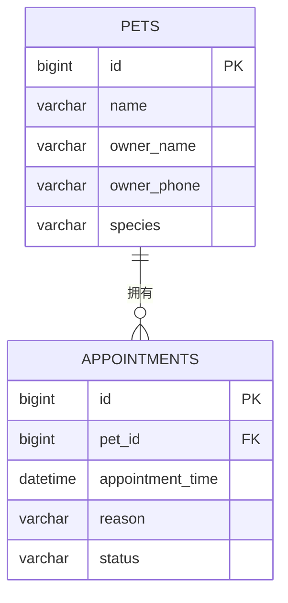

# 宠安心数据库设计（第 04 周）

本周实现“宠物建档后创建门诊预约”的最小闭环。生产环境使用 MySQL，测试和未配置 MySQL 的本地验证使用 H2 的内存模式；实体与字段保持一致。

## `pets` 宠物档案表

| 字段 | 类型 | 约束 | 说明 |
| --- | --- | --- | --- |
| `id` | BIGINT | 主键、自增 | 宠物标识 |
| `name` | VARCHAR(50) | 非空 | 宠物名称 |
| `owner_name` | VARCHAR(50) | 非空 | 主人姓名 |
| `owner_phone` | VARCHAR(20) | 非空 | 主人联系方式 |
| `species` | VARCHAR(30) | 非空 | 宠物种类，例如猫、狗 |

## `appointments` 预约表

| 字段 | 类型 | 约束 | 说明 |
| --- | --- | --- | --- |
| `id` | BIGINT | 主键、自增 | 预约标识 |
| `pet_id` | BIGINT | 非空、外键 → `pets.id` | 被预约的宠物 |
| `appointment_time` | DATETIME | 非空 | 就诊开始时间 |
| `reason` | VARCHAR(200) | 非空 | 就诊原因 |
| `status` | VARCHAR(20) | 非空 | 当前固定为 `SCHEDULED` |

`appointments` 在 `(pet_id, appointment_time)` 上设置唯一约束 `uk_appointment_pet_time`。它与 Service 的重复预约校验共同保证：同一只宠物不能在同一时间拥有两条预约记录。外键保证预约不能指向不存在的宠物。

## 数据准备与连接方式

自动化测试在每个测试中通过 Repository 创建宠物和预约测试数据，测试完成后由事务回滚或显式清理，因此可重复运行。MySQL profile 使用 JPA 的 `ddl-auto=update` 自动创建上述表；详细启动命令见根目录 README。
