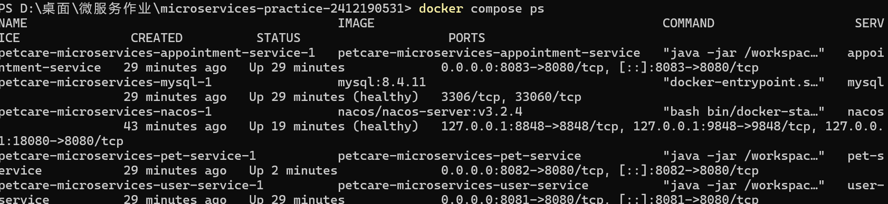
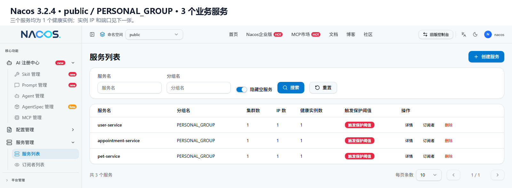
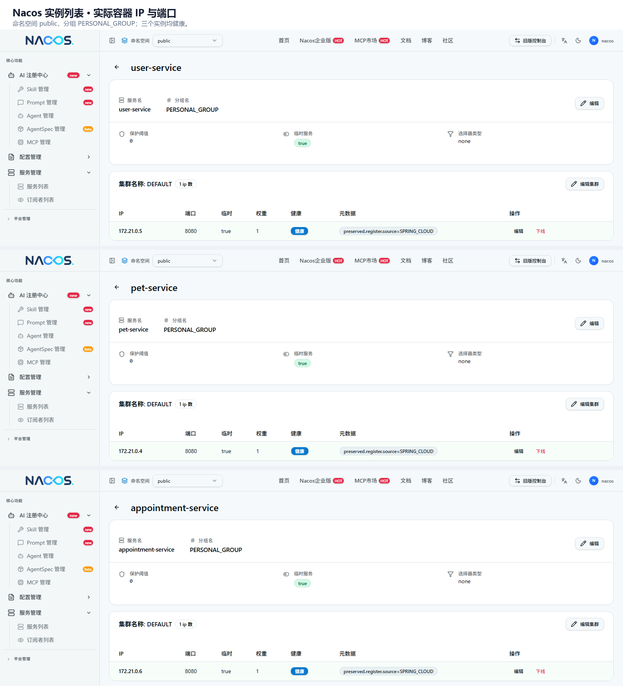
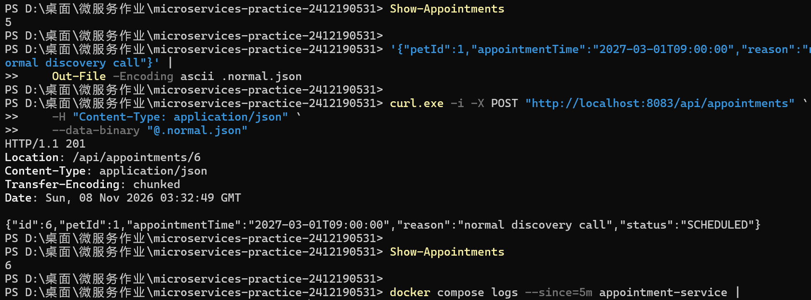
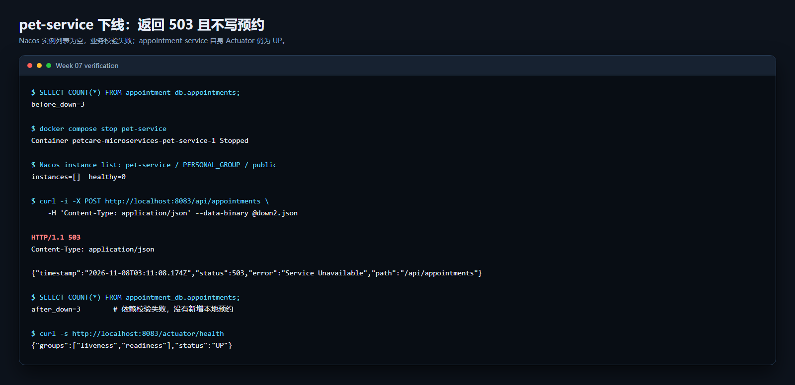
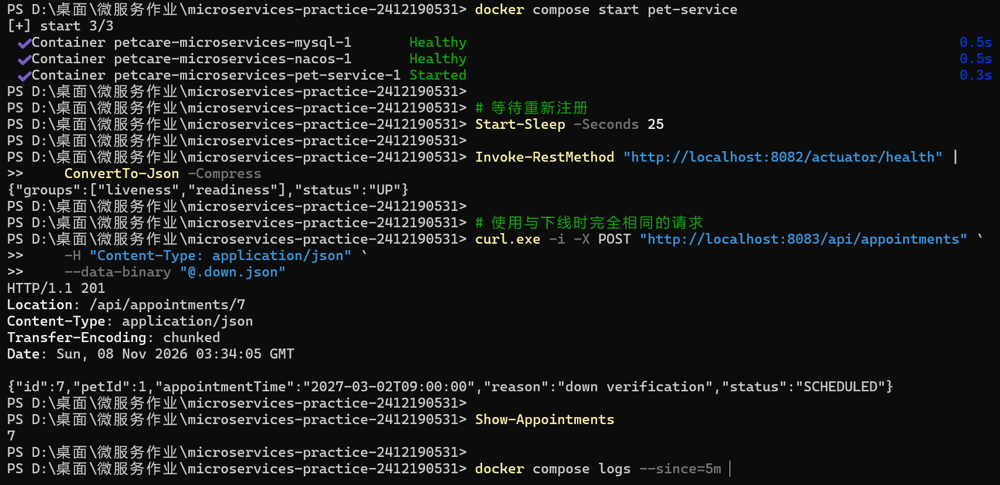
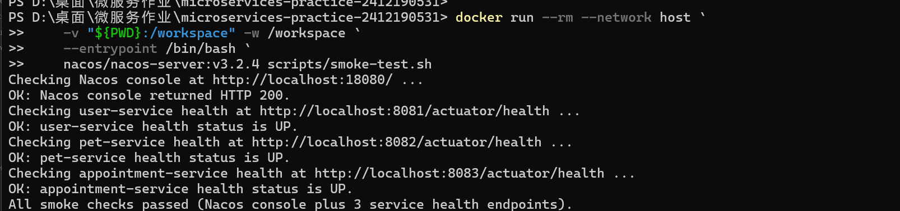
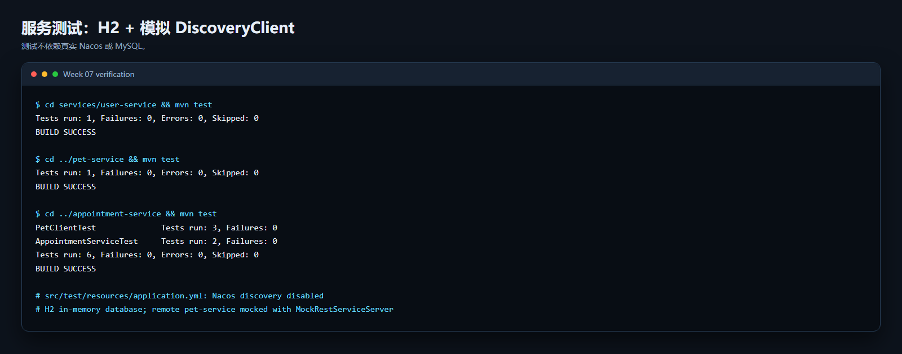

# 第 07 周：Nacos 注册发现与上下线验证

本周在第 06 周已拆分的 user-service、pet-service、appointment-service 上接入 Nacos 3.2.4，没有新建工程。服务名、数据归属和原有接口保持不变；预约创建流程从 Compose DNS 固定地址改为每次通过 `DiscoveryClient` 获取 pet-service 的当前实例。

## 1. Nacos 部署、初始化与注册

### 部署参数

| 项目 | 实际值 |
| --- | --- |
| Nacos 镜像 | `nacos/nacos-server:v3.2.4` |
| 运行模式 | standalone |
| 控制台 | <http://localhost:18080/>，映射容器 8080 |
| HTTP API | `http://localhost:8848` |
| SDK gRPC | `localhost:9848` |
| 命名空间 | `public`（`NACOS_NAMESPACE` 为空） |
| 分组 | `PERSONAL_GROUP` |
| 鉴权 | 开启，Token、Server identity 和管理员密码由根目录 `.env` 提供 |
| 持久化卷 | `petcare-microservices_nacos_data` -> `/home/nacos/data` |

控制台、HTTP、gRPC 端口均绑定 `127.0.0.1`，不暴露到公网。`docker compose up -d nacos` 后打开控制台，首次为 `nacos` 初始化管理员密码，密码与本地 `.env` 的 `NACOS_PASSWORD` 一致；初始化完成后 Nacos 的鉴权健康检查才会转为 healthy。之后再执行 `docker compose up -d --build` 启动 MySQL 与三个服务。

实际执行 `docker compose restart nacos` 后：管理员仍可登录，说明管理员数据已持久化；三个服务重新注册，实例数恢复为各 1 个。随后创建一条新预约（`2027-02-12T09:00:00`）返回 201（id=5），说明重启后服务发现与业务调用仍正常；该请求发生在下文下线/恢复截图之后。

真实 Token、身份值和密码只保存在未提交的 `.env`；仓库中的 `.env.example` 只有占位符。

### 注册结果

三个服务均使用 `spring.application.name` 注册到 `public / PERSONAL_GROUP`，Nacos 客户端版本由课程 BOM 统一管理：

| 服务名 | 实例 IP | 实例端口 | 健康实例数 |
| --- | --- | ---: | ---: |
| user-service | 172.21.0.5 | 8080 | 1 |
| pet-service | 172.21.0.4 | 8080 | 1 |
| appointment-service | 172.21.0.6 | 8080 | 1 |

容器内实例端口是 8080；宿主机映射端口分别是 8081、8082、8083。业务服务之间使用容器网络中的实例 IP:8080 通信。







## 2. 配置隔离与服务发现调用

### 调用方向与配置

业务流程为“创建预约前校验宠物”：

```text
客户端 -> appointment-service :8083
appointment-service -> Nacos（public / PERSONAL_GROUP）查询 pet-service 实例
appointment-service -> http://<发现的实例 IP>:8080/api/pets/{id}
pet-service -> 返回宠物；存在后 appointment-service 才写入 appointment_db
```

三个服务的 `spring.cloud.nacos.discovery` 都从环境变量读取地址、账号、密码、命名空间和分组：

```yaml
spring:
  cloud:
    nacos:
      discovery:
        server-addr: ${NACOS_SERVER_ADDR:localhost:8848}
        username: ${NACOS_USERNAME:nacos}
        password: ${NACOS_PASSWORD:}
        namespace: ${NACOS_NAMESPACE:}
        group: ${NACOS_GROUP:PERSONAL_GROUP}
```

Compose 内设置 `NACOS_SERVER_ADDR=nacos:8848`，三个服务的 `NACOS_GROUP` 同为 `PERSONAL_GROUP`。原 `PET_SERVICE_URL`、`pet-service.base-url` 已删除，只保留 Nacos 地址、数据库配置和 HTTP 超时。

### 寻址代码

`PetClient` 每次 `requirePet` 都重新调用 `DiscoveryClient.getInstances("pet-service")`，取当前实例 URI 后拼接原业务路径，不使用启动时缓存的固定地址：

```java
URI petServiceUri = discoverPetService();
PetSummary pet = restTemplate.getForObject(
        petServiceUri + "/api/pets/{id}", PetSummary.class, petId);
```

实例列表为空时抛出 `503 SERVICE_UNAVAILABLE`，不会继续写预约。远端宠物不存在时保留 `404`。HTTP 连接/读取超时仍为 2s/3s。

### 正常调用结果

请求：

```bash
curl -i -X POST http://localhost:8083/api/appointments \
  -H "Content-Type: application/json" \
  -d '{"petId":1,"appointmentTime":"2027-03-01T09:00:00","reason":"normal discovery call"}'
```

预期 `201`，实际 `201`，返回 `id=6`、`status=SCHEDULED`。预约总数从 5 变为 6。appointment-service 日志显示：

```text
Resolved pet-service to instance 172.21.0.4#8080##PERSONAL_GROUP@@pet-service (http://172.21.0.4:8080)
Discovered pet-service at http://172.21.0.4:8080 for petId=1
```



## 3. 健康状态、下线与恢复

### 下线验证

```bash
docker compose stop pet-service
```

等待 Nacos 中 `pet-service` 的实例列表变为空（`instances=[]`）。使用新的有效业务时间发起请求：

```bash
curl -i -X POST http://localhost:8083/api/appointments \
  -H "Content-Type: application/json" \
  -d '{"petId":1,"appointmentTime":"2027-03-02T09:00:00","reason":"down verification"}'
```

结果：

| 检查项 | 下线后结果 |
| --- | --- |
| Nacos 中 pet-service 实例 | 0 |
| 业务请求 | `HTTP 503 Service Unavailable` |
| `appointment_db.appointments` | 下线前 6，失败后仍为 6，没有绕过校验新增记录 |
| appointment-service `/actuator/health` | `{"groups":["liveness","readiness"],"status":"UP"}` |



### 恢复验证

```bash
docker compose start pet-service
# 等待 pet-service Actuator UP 且 Nacos 重新出现 1 个健康实例
```

恢复后 Nacos 实例为 `172.21.0.4:8080`，`healthy=true`。用同一个 `2027-03-02T09:00:00` 请求重试，返回 `201`，`id=7`；预约总数从 6 变为 7。无需修改 appointment-service 的任何地址。



### 三种“健康”的区别

- **SDK 连接存活**：appointment-service 的 Nacos Client 与 Nacos 8848/9848 保持连接和心跳。连接存活只说明注册中心通信正常，不代表 pet-service 可用。
- **注册实例状态**：Nacos 根据心跳、实例元数据和生命周期判断实例是否健康。`docker compose stop pet-service` 触发优雅停机并注销实例，列表随后为空；如果 Actuator 因数据库故障变为 DOWN，Nacos 不会自动据此摘除实例，仍可能把流量发给该实例。
- **Actuator 应用健康**：`/actuator/health` 主要反映本应用进程、数据库等自身组件。pet-service 下线时 appointment-service 的 Actuator 仍为 UP，但它对 pet-service 的业务校验返回 503，说明应用健康不等于依赖健康。

另外，服务发现只解决“找到可用实例”，不能消除“远端校验成功、本地预约写入失败”的部分成功窗口。本实验不引入自动补偿、重试或分布式事务。

## 4. 验证脚本与测试

### smoke-test.sh

脚本从仓库根目录运行：

```bash
bash scripts/smoke-test.sh
```

检查项：

1. `NACOS_CONSOLE_URL`（默认 `http://localhost:18080`）控制台页面可访问，不使用旧版 `8848/nacos` 控制台地址。
2. user-service、pet-service、appointment-service 的 `/actuator/health` 可达且 JSON 状态为 `UP`。
3. 任一检查失败时累计错误并最终 `exit 1`，不会把失败报告为成功。

实际结果：全部通过时打印 4 个 `OK` 并 `exit=0`；将 appointment-service 地址改为不可达端口后，脚本打印 `FAIL` 并 `exit=1`。

本次 Windows 环境使用带 `curl` 的 Linux 容器、`--network host` 和仓库根目录挂载来执行同一个 bash 脚本，因此截图中的默认地址仍是本机 18080/8081/8082/8083；在安装 Git Bash 或 Linux 主机的终端中直接运行上述命令即可。



### 服务测试

测试关闭 Nacos 自动注册，使用 H2 内存数据库，并模拟 `DiscoveryClient` 和远程 HTTP 响应，不依赖真实 Nacos 或 MySQL：

```bash
cd services/user-service && mvn test
cd ../pet-service && mvn test
cd ../appointment-service && mvn test
```

结果：user-service 1 个测试、pet-service 1 个测试、appointment-service 6 个测试全部通过。appointment-service 覆盖：

- 每次调用重新获取实例地址，实例变化后使用新地址；
- 实例列表为空返回 503 且不写预约；
- 远端宠物不存在保留 404；
- 正常通过发现实例创建预约。



## 5. 文件与整体结论

| 内容 | 位置 |
| --- | --- |
| Nacos、MySQL、三个业务服务编排 | `compose.yaml` |
| 环境变量模板 | `.env.example` |
| Nacos 依赖与注册配置 | `services/*/pom.xml`、`services/*/src/main/resources/application.yml` |
| DiscoveryClient 寻址 | `services/appointment-service/src/main/java/com/zjgsu/chr/appointment/client/PetClient.java` |
| 空实例测试 | `services/appointment-service/src/test/java/com/zjgsu/chr/appointment/client/PetClientTest.java` |
| 服务测试配置 | `services/*/src/test/resources/application.yml` |
| 烟雾测试 | `scripts/smoke-test.sh` |

整体验证结论：三个服务已成功注册到同一 Nacos 分组；预约创建通过发现到的 pet-service 实例完成真实调用；停止 pet-service 后实例下线、接口返回 503 且不新增预约；恢复后重新注册，同一请求成功；Actuator、脚本和离线测试结果与上述结论一致。
