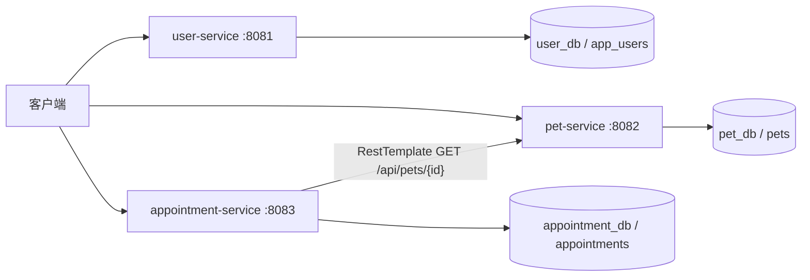

# 宠安心微服务拆分设计

## 拆分映射与服务边界

第 04 周单体中的宠物档案与预约模块拆分为三个按业务能力划分的服务，而不是按 Controller、Service、Repository 技术层拆分。`monolith/` 保留为原始单体版本，用于与拆分后的服务对照。

| 单体模块 | 微服务 | 端口 | 职责 | 独立数据库与拥有表 |
| --- | --- | ---: | --- | --- |
| 主人资料（由宠物主人信息演进） | user-service | 8081 | 管理主人基本资料 | `user_db`：`app_users` |
| 宠物档案 | pet-service | 8082 | 管理宠物资料，仅保存主人 ID | `pet_db`：`pets` |
| 预约管理 | appointment-service | 8083 | 校验宠物、创建预约、校验重复预约 | `appointment_db`：`appointments` |

每个服务只读写自己数据库中的表：`pets.owner_id` 与 `appointments.pet_id` 都只是跨服务 ID，不建立跨库外键。服务不得直接使用其他服务的 Repository。

## 调用关系

预约创建流程为：客户端请求 appointment-service；预约服务先使用 `RestTemplate` 调用 pet-service 的 `GET /api/pets/{id}` 校验宠物存在；宠物存在后才在 `appointment_db` 写入预约。宠物不存在返回 404；宠物服务超时或不可用返回 503，预约服务不会写入本地数据。

## 设计结论

用户、宠物和预约分别具有独立的数据生命周期与演进节奏。将宠物校验保留为 HTTP 协作可以避免预约服务读写宠物表，同时让服务不可用、超时和远端资源不存在等失败情况可以被明确处理。该流程仍存在“远端校验成功后、本地写入失败”的窗口；本周仅记录并处理基本失败，不实现分布式事务、补偿或消息机制。
